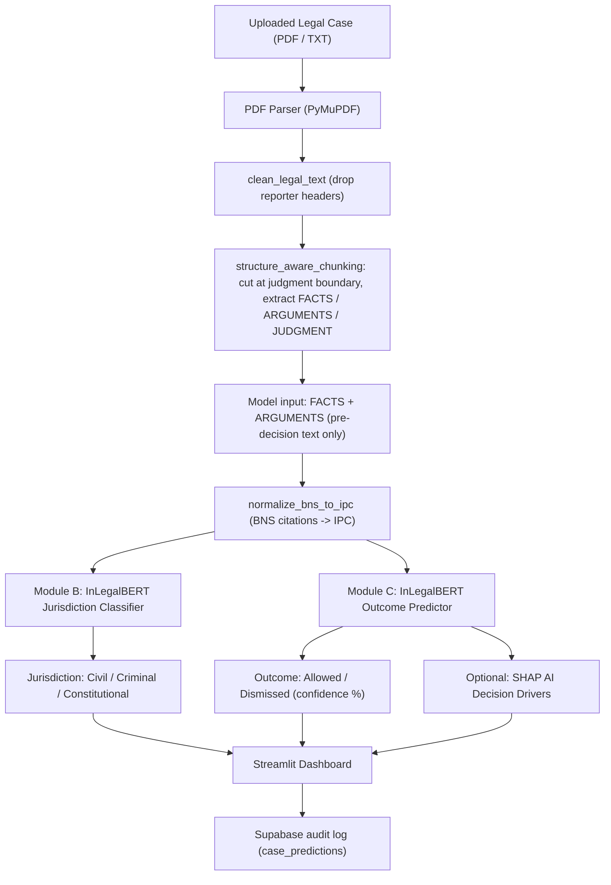

# ⚖️ Agent Guide: Realistic Legal Justice Prediction (Legal AI Hub)

> **Document Purpose**: This file serves as the definitive, single-source-of-truth architectural and technical manual for any AI agent or developer working on, extending, or maintaining the **Realistic LJP (Legal AI Hub)** codebase.

---

## 1. Executive Summary & Project Purpose

### 1.1 The Real-World Judicial Problem
In the Indian Judicial System, over **45 to 50 million cases** are currently pending across District Courts, High Courts, and the Supreme Court. A significant bottleneck is the manual analysis of lengthy appellate petitions (30 to 100+ pages) and lower-court trial records. 
Key systemic challenges include:
1. **Document Overload**: Judicial officers and advocates spend hours reading unstructured legal judgments to extract key arguments, statutory citations, and procedural histories.
2. **Outcome Uncertainty**: Litigants and advocates lack objective, data-driven foresight into appellate viability (whether an appeal is statistically likely to be *Allowed* or *Dismissed*).
3. **The "Black Box" Resistance**: Legal professionals cannot adopt generic "black box" machine learning models; judges and advocates require transparent rationale, statutory citations, and explainability.
4. **The 2024 Indian Penal Reform**: Effective July 1, 2024, India replaced the 164-year-old **Indian Penal Code (IPC 1860)** with the **Bharatiya Nyaya Sanhita (BNS 2023)**, creating an urgent need for automated statutory cross-referencing.

### 1.2 The Systemic Solution: Legal AI Hub
**Legal AI Hub** is an end-to-end decision-support prototype for the Indian legal domain. It combines:
- **Domain-Specific Transformer NLP**: Fine-tuned `InLegalBERT` models for two tasks (Legal Jurisdiction & Appellate Outcome).
- **Structure-Aware Document Processing**: Extraction of facts and arguments from court judgment PDFs (`FACTS`, `ARGUMENTS`, `JUDGMENT`), cut at the judgment boundary so the verdict does not leak into the model input.
- **Explainability**: SHAP "AI Decision Drivers" showing which words pushed the outcome prediction.
- **Statutory Cross-Reference**: IPC to BNS mapping shown alongside the document (display only; models read IPC citations).
- **Role-Based Access Control (RBAC)**: Workflows for Judges, Lawyers, Law Students and Administrators, enforced in the UI and by database row-level security.
- **Cloud Persistence**: Supabase (PostgreSQL) for the case vault, Lab queries, prediction history and role requests.

Measured accuracy on a 120-case benchmark (before the latest pipeline fixes): Module B jurisdiction 76.67% (macro F1 68.47%), Module C outcome 67.50% (macro F1 66.66%). See `eval_harness/RESULTS.md`.

---

## 2. Directory Structure & File Map

The root workspace holds only the runtime components; academic artifacts, presentations, screenshots and drafts live under `Documents/`:

```
AI-for-Legal-Case/
│
├── app.py                      # Core application: Streamlit UI, RBAC router, preprocessing, inference, SHAP, Supabase client
├── bns_mapping.json            # IPC -> BNS dictionary (e.g. "section 302" -> "Section 103 of BNS (Murder)")
├── schema.sql                  # Supabase schema, triggers and RLS policies (replaces migration.sql + role_system_setup.sql)
├── requirements.txt            # Python dependencies (Streamlit, PyTorch, Transformers, SHAP, PyMuPDF, Supabase, pytest, ...)
├── check_setup.py              # Demo-readiness check: venv, packages, RAM, model files, test prediction, Supabase
├── run_demo.bat                # Windows launcher: activates venv, runs check_setup.py, starts Streamlit
├── README.md                   # Overview, quick start, measured metrics
├── SETUP.md                    # Step-by-step install and Supabase setup (incl. first Admin)
├── agent.md                    # THIS FILE: architecture and runtime technical reference
├── implementation_summary.md   # Current module list and recent fixes
├── avatar.jpg                  # Image asset (not referenced by app.py)
│
├── .streamlit/
│   ├── config.toml             # Theme tokens and server settings
│   └── secrets.toml            # SUPABASE_URL, SUPABASE_KEY, optional ALLOW_OFFLINE_ADMIN_DEMO (gitignored, create locally)
│
├── tests/
│   └── test_pipeline.py        # pytest regression tests (translation, leakage cut, fallbacks, XSS, SHAP, windows)
│
├── eval_harness/
│   ├── build_benchmark_cohort.py  # Builds the 120-case stratified cohort from original_data/ (gitignored)
│   ├── run_eval.py             # Evaluates Module B/C using prepare_document() from app.py
│   ├── RESULTS.md              # Diagnostic report and measured metrics
│   └── results/                # JSON outputs of evaluation runs
│
├── models/                     # Fine-tuned weights (gitignored; downloaded from Hugging Face if missing)
│   ├── Module_B/Final/         # Jurisdiction classifier (config.json, model.safetensors, tokenizer files)
│   └── Module_C/Final/         # Outcome predictor (config.json, model.safetensors, tokenizer files)
│
├── Model Test pdfs/            # Sample Supreme Court / High Court judgments for manual testing
│
└── Documents/                  # Academic and presentation material (not used at runtime)
    ├── Research paper doc/     # Papers, blackbook chapters, figures, architecture diagrams, poster
    ├── Front end SS/           # Screenshots of the interface
    ├── BTech project Final Black book report format 24-25-1.docx
    ├── BNS_IPC_Comparative.pdf
    ├── In our word or reseach paper.docx
    ├── Issues face while making project-.txt
    ├── 🎤 Final Year Project Presentation Script.docx
    └── diagnostic_report.md    # Older diagnostic report (superseded by eval_harness/RESULTS.md)
```

---

## 3. Technology Stack & Architectural Dependencies

Versions are the ranges pinned in `requirements.txt`.

| Layer | Component | Version / Identifier | Purpose |
| :--- | :--- | :--- | :--- |
| **Frontend UI** | Streamlit | `>=1.40,<2` | Reactive web application dashboard |
| **Language** | Python | `3.10` / `3.11` recommended | Core runtime (`check_setup.py` accepts 3.10-3.13) |
| **Deep Learning** | PyTorch & Transformers | `torch>=2.2,<3`, `transformers>=4.40,<6` | Model execution and classification heads |
| **Foundation Model** | `law-ai/InLegalBERT` | Hugging Face Hub | Domain-adapted BERT pre-trained on Indian court judgments |
| **Remote Model Hub** | Hugging Face Model Hub | `Nick1027/legal-case-outcome-predictor` | Hosts the Module B & C checkpoints; used when `./models` is missing |
| **Explainability** | SHAP | `shap>=0.45,<1` | "AI Decision Drivers" panel (Partition explainer, text masker) |
| **Document Parser** | PyMuPDF (`pymupdf` / `fitz`) | `>=1.24,<2` | PDF text extraction |
| **Database & Auth** | Supabase | `supabase>=2.0,<3`, `httpx` | PostgreSQL, email/password auth, row-level security |
| **Data Handling** | Pandas & NumPy | `pandas>=2.2`, `numpy>=1.26` | Tables for history and evaluation |
| **Evaluation** | scikit-learn | `>=1.4,<2` | Metrics in `eval_harness/run_eval.py` |
| **Testing** | pytest | `>=8.0` | `tests/test_pipeline.py` |
| **Data Dict** | `bns_mapping.json` | Local JSON | IPC -> BNS section mapping |

---

## 4. Machine Learning & Inference Pipeline

The system uses a **dual-transformer pipeline** with a rule-based fallback when the models cannot be loaded:



By default each model reads the **first 512 tokens** of the model input (`predict()`). The opt-in checkbox **"Analyse full document (sliding window, slower)"** switches to `predict_windows()`, which scores up to 8 overlapping 512-token windows (stride 128) in one batch and averages the probabilities. The default stays first-512 because the reported benchmark numbers were measured on that path.

### 4.1 Foundation Model: InLegalBERT
Generic transformer models struggle with Indian legal texts because of specialised vocabulary (*Coram*, *impugned judgment*, *prima facie*, *suo motu*), procedural formatting and statutory citations. This project fine-tunes **InLegalBERT** (`law-ai/InLegalBERT`), a BERT model pre-trained on Indian court judgments.

### 4.2 Module B: Domain & Jurisdiction Classifier
- **Location**: `./models/Module_B/Final` (or `Module_B` subfolder on Hugging Face)
- **Labels** (`JURISDICTION_LABELS`): `0` Civil Law, `1` Criminal Law, `2` Constitutional Law
- **Architecture**: InLegalBERT sequence classification with a 3-class head.
- **Call**: `predict(crit, t_b, m_b, JURISDICTION_LABELS, task="jurisdiction")`

### 4.3 Module C: Appellate Outcome Predictor
- **Location**: `./models/Module_C/Final` (or `Module_C` subfolder on Hugging Face)
- **Labels** (`OUTCOME_LABELS`): `0` Dismissed / Rejected, `1` Allowed / Accepted
- **Architecture**: InLegalBERT sequence classification with a 2-class head.
- **Call**: `predict(crit, t_c, m_c, OUTCOME_LABELS, task="outcome")`

If a checkpoint has more output labels than the app maps, `_mapped_probs()` re-normalises the softmax over the mapped labels only (a warning is logged at load time).

### 4.4 Model Loading (`_load_one` / `load_models`)
In `app.py` each module is loaded by `_load_one()`:

```python
def _load_one(module):
    local_dir = LOCAL_MODEL_DIRS[module]
    if os.path.isfile(os.path.join(local_dir, "config.json")):
        src, kwargs = local_dir, {}
    else:
        src, kwargs = HF_MODEL_REPO, {"subfolder": f"Module_{module}"}
    try:
        tok = AutoTokenizer.from_pretrained(src, use_fast=True, **kwargs)
    except Exception:
        tok = AutoTokenizer.from_pretrained("law-ai/InLegalBERT", use_fast=True)
    mdl = AutoModelForSequenceClassification.from_pretrained(src, **kwargs)
    mdl.eval()
    return tok, mdl
```

- The **fast** tokenizer (`use_fast=True`) is required: the sliding-window mode and the SHAP panel use `return_overflowing_tokens` / `return_offsets_mapping`, which only fast tokenizers support.
- Each module uses its own saved tokenizer; if that fails, the `law-ai/InLegalBERT` tokenizer is used.
- If `./models/Module_X/Final/config.json` is missing, the module is downloaded from `Nick1027/legal-case-outcome-predictor` (needs internet).
- `load_models()` is wrapped in `@st.cache_resource` and returns `(t_b, m_b, t_c, m_c, model_load_error)`. The error is classified as `transformers_unavailable`, `files_missing`, `out_of_memory` (incl. Windows OS error 1455) or `other: ...`, and the Predictor shows a matching warning. `MODELS_READY` is true only when all four objects loaded.

### 4.5 Rule-Based Fallback
If the models are not loaded, `predict()` falls back to keyword rules:
- `constitution(al)`, `article N`, `fundamental right(s)`, `writ` -> Constitutional Law.
- `murder`, `ipc`, `accused`, `police`, `fir`, `bail`, `convict(ed/ion)` -> Criminal Law.
- Otherwise -> Civil Law.
- Outcome: `no merit`, `devoid of merit`, `conviction affirmed/upheld` -> Dismissed; otherwise Allowed.

The fallback returns **no confidence value** (`None`). The UI shows "rule-based estimate (model not loaded)" instead of a percentage, and the SHAP panel is disabled. If model inference itself raises an error, `predict()` returns `(None, None)` and the UI shows an error instead of a prediction; nothing is logged to the database.

---

## 5. Text Processing & Statutory Translation Engine

All preprocessing goes through one function, `prepare_document(raw_text)`, shared by the app and `eval_harness/run_eval.py`. It returns `(clean_text, sections, model_input)`:

```python
def prepare_document(raw_text):
    clean = clean_legal_text(raw_text)
    sections, crit = structure_aware_chunking(clean)
    return clean, sections, normalize_bns_to_ipc(crit)
```

### 5.1 PDF Extraction (`extract_text_from_pdf`)
- Uses PyMuPDF (`fitz.open(stream=..., filetype="pdf")`) and joins the text of all pages.
- Falls back to plain UTF-8 decoding if PyMuPDF is not installed. TXT uploads are decoded directly.

### 5.2 Legal Text Cleaning (`clean_legal_text`)
Drops everything before the first `HEADNOTE`, `JUDGMENT` or `ORDER` heading (judge names, court, dates, bench details), skipping "DATE OF JUDGMENT" lines:
```python
pattern = r'(?i)^.*?(?:\bHEADNOTE\b[\s:\"\-]*|\n[ \t]*(?<!DATE OF )\bJUDGMENT\b[\s:\"\-]*|\n\s*ORDER\s*[\s:\"\-]*)(\n|$)'
```

### 5.3 Structure-Aware Chunking & Judgment Boundary (`structure_aware_chunking`)
1. Strips reporter metadata (equivalent citations, author, bench) at the top.
2. Finds the **judgment boundary**: the first match of `final judgment`, `operative order/part`, `in the result`, `for the (foregoing) reasons` or `conclusion` that lies after the first 30% of the text (earlier mentions, e.g. a table of contents, are ignored).
3. Searches for **FACTS** and **ARGUMENTS** only in the text *before* that boundary, so the court's final order can never leak into the model input. Everything after the boundary is the **JUDGMENT** section (display only).
4. Model input (`crit`) = FACTS + ARGUMENTS; if neither is found, the first 2,500 characters of the pre-decision text are used.

### 5.4 IPC <-> BNS Handling
India's July 2024 reform replaced the IPC with the Bharatiya Nyaya Sanhita (BNS). `bns_mapping.json` maps IPC sections to BNS (e.g. `section 302` -> `Section 103 of BNS (Murder)`). `_compile_statute_tools()` builds one combined regex per direction, so each citation is replaced exactly once.
- **`translate_laws_to_bns(text)` — display only, single pass.** Annotates IPC citations while keeping the original words, e.g. `section 302 [Section 103 of BNS (Murder)]`. Used for the Full Text tab. (The old version ran one substitution per key and re-translated its own output.)
- **`normalize_bns_to_ipc(text)` — model input.** The models were fine-tuned on IPC-era judgments, so BNS citations in new judgments are rewritten to their IPC equivalent (`Section 103 of BNS` -> `Section 302 of the IPC`) before inference.
- **`find_statute_mappings(text)`** lists each distinct IPC citation once with its BNS equivalent for the IPC -> BNS tab and for saving to the vault.

---

## 6. Authentication & Role-Based Access Control (RBAC)

Roles are stored in the Supabase `profiles` table and enforced both in the sidebar router and by row-level security in the database.

### 6.1 Role Matrix & Permission Mapping

| Role | Accessible Modules | Key Capabilities |
| :--- | :--- | :--- |
| **Lawyer** | 🎯 Case Predictor, 📚 Research Vault | Upload judgments, run predictions and SHAP, save cases to their own vault, search their vault. |
| **Judge** | 📋 Case History | Review the prediction history of **all** users (with user email column). |
| **Student** | 🔬 IPC-BNS Lab | IPC <-> BNS lookup assistant (e.g. `302` -> BNS 103), related vault cases. |
| **Admin** | 🎯 Predictor, 📚 Vault, 🔬 Lab, 📋 History, 🛡️ Role Requests | All modules; sees all vault cases and history; approves or rejects role requests. |

Non-Admin users can request a role upgrade from the sidebar ("Request Role Upgrade"); the request is stored in `role_requests` and reviewed by an Admin.

### 6.2 Authentication Flow in `app.py`
1. Unauthenticated users see the **Legal AI Hub** sign-in card (email + password, **Sign In** / **Create Account**).
2. **Online (Supabase connected):**
   - There is **no role picker**. On sign-in the role is read from `profiles` by `user_id`; if no row is found, the session falls back to `Student`.
   - New accounts are created through Supabase Auth; the `on_auth_user_created` trigger in `schema.sql` always creates the profile as `Student` (sign-up metadata is ignored). Only an Admin (or the SQL editor) can change a role; a trigger blocks other role changes.
3. **Offline demo (Supabase unreachable or no secrets):**
   - A **Demo Role** picker is shown (Student / Lawyer / Judge / Admin) and nothing is saved.
   - **Admin** is refused offline unless `ALLOW_OFFLINE_ADMIN_DEMO = true` is set in `.streamlit/secrets.toml` (or as an environment variable), because no credentials can be checked.
4. Supabase reachability is re-checked every 60 seconds instead of being cached forever.

---

## 7. Application Modules in Detail

### 7.1 Module 1: Case Predictor (`render_predictor`)
- **Inputs**: Court Level selector, Statutory Tags text field (saved with the case as `key_issues`), and the opt-in **Analyse full document (sliding window, slower)** checkbox. There is no manual domain picker; the jurisdiction is predicted by Module B.
- **Upload**: `.pdf` or `.txt`. The analysis is cached by file hash + mode, so Streamlit reruns do not re-run the models or insert duplicate `case_predictions` rows.
- **Legal-document check**: if the text does not look like a judgment (too few legal keywords / no sections), the result is marked "UNRELIABLE — NOT A LEGAL DOCUMENT" and saving is disabled.
- **Results card**: outcome badge (green for Allowed, red for Dismissed), jurisdiction with confidence, outcome confidence bar, a note that it is a decision-support estimate (~68% measured outcome accuracy), and which text was analysed (first 512 tokens or N windows). In fallback mode it shows "rule-based estimate" with no percentage.
- **AI Decision Drivers (SHAP)** (`render_decision_drivers` / `explain_outcome`): button **Generate AI Decision Drivers** runs `shap.Explainer` with `shap.maskers.Text` (Partition explainer) on the outcome model over the first 256 tokens of the model input (max 300 evaluations). Shows the top words pushing toward / against the predicted outcome and a colour-highlighted passage. Needs the models and the `shap` package; takes roughly 30-90 s on CPU.
- **Document Analysis tabs**: Facts, Arguments, Judgment, **IPC → BNS** (table of IPC citations and BNS equivalents; "the models read the original citations; BNS equivalents are shown for reference only"), Full Text (with BNS annotations).
- **Save to Research Vault**: inserts title, summary, outcome, jurisdiction, ratio (start of the JUDGMENT section), IPC/BNS sections, statutory tags, court level and confidences into `cases_vault`.
- All document and user text rendered as HTML is escaped (`html.escape`) to prevent XSS.

### 7.2 Module 2: Research Vault (`render_vault`)
- **Search** box: matches case name, summary, category, IPC/BNS sections and statutory tags (`ilike` across columns); special characters are stripped from the term.
- **Visibility**: users see their own cases; Admin and Judge see all cases (also enforced by RLS).
- 3-column card grid: category badge, date, title, summary snippet, outcome badge and confidence ("—" when confidence is missing). Shows the latest 12 cases, or up to 24 search results.

### 7.3 Module 3: IPC-BNS Translation Lab (`render_lab`)
- **Left column**: up to 3 related vault cases whose title or summary match the last section number / keyword asked.
- **Right column (AI Legal Assistant)**: chat interface. `lookup_statute()` finds section numbers (several per question) or keywords (e.g. `murder`) in `bns_mapping.json` and returns up to 5 IPC -> BNS matches. This is a dictionary lookup, not a generative model.
- Chat text is escaped; `**bold**` is rendered with `chat_markup()`.
- Each query and response is saved to `student_queries` when the database is connected.

### 7.4 Module 4: Case History & Audit Log (`render_history`)
- Reads `case_predictions`: Admin and Judge see all users' rows (with a User Email column); other roles see only their own.
- Columns: `Case File` | `Jurisdiction` | `Jurisdiction %` | `Outcome` | `Confidence %` | `Date`.

### 7.5 Module 5: Role Requests (`render_role_requests`, Admin only)
- **Pending Approvals** and **Resolved History** tabs over `role_requests`.
- Approve updates the request status and the user's role in `profiles`; Reject marks the request rejected.

---

## 8. Database Architecture & Schema (`schema.sql`)

The backend is **Supabase (PostgreSQL)**. `schema.sql` replaces the old `migration.sql` and `role_system_setup.sql`. It is safe to run more than once: it never drops tables, adds missing `user_id` columns to databases created by the old scripts (back-filling them from `profiles` by email), drops the old open policies and recreates per-user ones. Run it in the Supabase SQL Editor (see `SETUP.md`).

### 8.1 Schema Overview

| Table | Purpose | Key columns |
| :--- | :--- | :--- |
| `profiles` | One row per auth user with their role | `user_id` (unique, FK `auth.users`), `email`, `role` (`Student` default; `Student`/`Lawyer`/`Judge`/`Admin`) |
| `case_predictions` | Audit log of predictions | `user_id` (default `auth.uid()`), `user_email`, `filename`, `predicted_jurisdiction`, `jurisdiction_confidence`, `predicted_outcome`, `outcome_confidence`, `created_at` |
| `cases_vault` | Saved cases for the Research Vault | `user_id`, `user_email`, `title`, `summary`, `key_issues`, `ratio_decidendi`, `relevant_sections_ipc`, `relevant_sections_bns`, `case_category`, `court_level`, `predicted_jurisdiction`, `predicted_outcome`, confidences |
| `student_queries` | IPC-BNS Lab chat log | `user_id`, `user_email`, `query_text`, `ai_response`, `related_case_id` |
| `statutory_bridge` | IPC -> BNS reference table (not read by the current app, which uses `bns_mapping.json`) | `ipc_section` (unique), `bns_equivalent`, `change_description`, `landmark_precedent` |
| `role_requests` | Role upgrade requests | `user_id`, `user_email`, `"current_role"` (quoted: reserved word), `requested_role`, `status` (`pending`/`approved`/`rejected`), `requested_at`, `reviewed_at`, `reviewed_by` |

Helper functions (`security definer`, avoid RLS recursion): `current_app_role()`, `is_admin()`, `is_reviewer()` (Admin or Judge). Triggers: `on_auth_user_created` (new users are always `Student`) and `trg_protect_profile_role` (only Admins can change a role).

### 8.2 Row-Level Security (RLS)
RLS is enabled on all six tables:
- **`case_predictions`, `cases_vault`**: users read and insert **their own rows** (`user_id = auth.uid()`); **Admin and Judge read all rows**. Vault update/delete: owner or Admin.
- **`student_queries`**: own rows; Admin reads all.
- **`profiles`**: users read their own profile; Admins read all and update roles. No direct inserts (the trigger creates rows).
- **`role_requests`**: users insert their own `pending` requests and read their own; Admins read all and update.
- **`statutory_bridge`**: readable by everyone; only Admins write.

---

## 9. Design System & Frontend Tokens

The application interface follows a **Professional White Theme** optimized for high-density legal work:
- **Primary Background**: `#F8FAFC` (Slate 50)
- **Card Background**: `#FFFFFF` with subtle border `#E2E8F0` and micro-elevations (`box-shadow: 0 1px 3px rgba(0,0,0,0.04)`)
- **Primary Accent / Brand**: `#1E3A5F` (Deep Judicial Navy Blue)
- **Positive / Favorable Badge**: `#ECFDF5` background with `#059669` emerald text
- **Risk / Dismissal Badge**: `#FEF2F2` background with `#DC2626` crimson text
- **Typography**: Google Fonts `'Inter'` (body) and `'Plus Jakarta Sans'` (headings); Google Material Symbols Outlined for legal iconography (`balance`, `gavel`, `inventory_2`, `forum`, `smart_toy`).

---

## 10. How to Run & Verify the Project Locally

### 10.1 Environment Initialization
Python 3.10 or 3.11 is recommended:
```powershell
# 1. Create and activate the virtual environment (once)
python -m venv venv
.\venv\Scripts\Activate.ps1

# 2. Install dependencies
pip install -r requirements.txt
```

### 10.2 Database Credentials (`.streamlit/secrets.toml`)
Create `.streamlit/secrets.toml` (gitignored) with valid Supabase keys, and run `schema.sql` once in the Supabase SQL Editor:
```toml
SUPABASE_URL = "https://your-project-id.supabase.co"
SUPABASE_KEY = "your-anon-public-key"
# Optional, local demo only: allow the Admin role in offline demo mode
# ALLOW_OFFLINE_ADMIN_DEMO = true
```
If the keys are missing or Supabase is unreachable, the app runs in offline demo mode (nothing is saved). Never use the `service_role` key here. See `SETUP.md` for creating the first Admin.

### 10.3 Launching the Application
- **Windows, one click:** double-click `run_demo.bat`. It activates `venv`, runs `python check_setup.py`, pauses if any check fails, then starts Streamlit.
- **Manual:**
  ```powershell
  python -m streamlit run app.py
  ```
Access the application at `http://localhost:8501`.

### 10.4 Verification
```powershell
python check_setup.py           # PASS / WARN / FAIL for: Python & venv, packages, free RAM, model files,
                                # model loading, a real test prediction, Supabase secrets, reachability and schema
python check_setup.py --shap    # also times one SHAP explanation
python -m pytest tests -q       # pipeline regression tests (model tests skipped if ./models is missing)
python eval_harness/run_eval.py # re-measure Module B / C metrics (needs eval_harness/benchmark_cohort.csv)
```

---

## 11. Developer & Agent Troubleshooting Guidelines

1. **Tokenizer errors**:
   - The app needs a **fast** tokenizer (`use_fast=True`) for sliding-window mode and SHAP. If a module's saved tokenizer fails to load, `_load_one()` falls back to the `law-ai/InLegalBERT` tokenizer (needs internet the first time). Do not switch to `use_fast=False`: `return_overflowing_tokens` and `return_offsets_mapping` would break.
2. **Missing local model weights**:
   - If `./models/Module_B/Final` or `./models/Module_C/Final` is missing, the app downloads the module from [Nick1027/legal-case-outcome-predictor](https://huggingface.co/Nick1027/legal-case-outcome-predictor). Offline and without weights, the Predictor runs the rule-based fallback (no confidence shown) and the SHAP panel is disabled. `check_setup.py` reports which case applies.
3. **Out of memory / Windows OS error 1455**:
   - Run inside the project `venv` and close other heavy apps; the models need about 1.5 GB of free RAM.
4. **Database connectivity**:
   - Supabase calls are wrapped in `try...except`; when Supabase is unreachable the app degrades to offline demo mode. The health check is re-run every 60 seconds. If `check_setup.py` reports a schema failure, run `schema.sql`.
5. **Preprocessing changes**:
   - Change `prepare_document()` / `structure_aware_chunking()` in `app.py` only; `eval_harness/run_eval.py` imports them, so evaluation and app stay in sync. Keep the judgment-boundary cut so the final order never reaches the model, then run `python -m pytest tests -q` and re-run the evaluation.
6. **Modifying navigation & roles**:
   - Module access per role is the `allowed_modules` dictionary in the sidebar router in `app.py`. Data access is enforced separately by RLS in `schema.sql`; update both when changing permissions.
