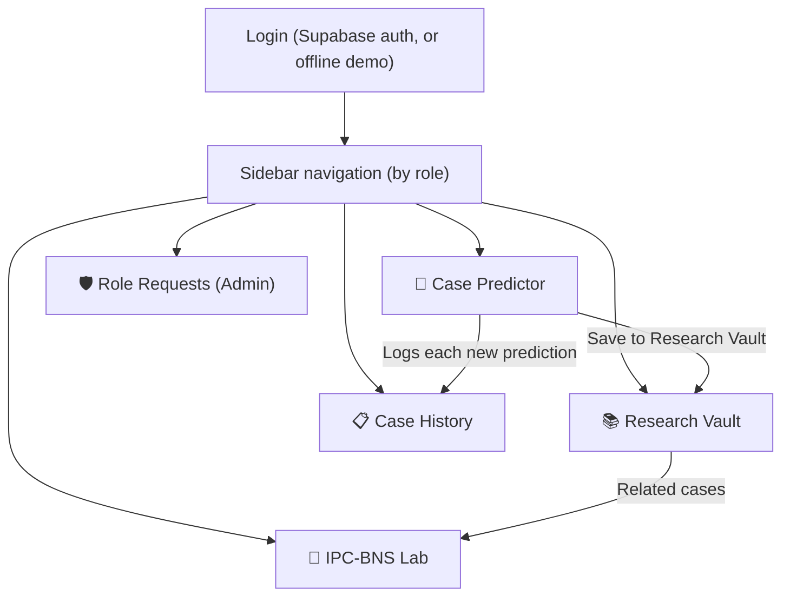

# Legal AI Hub — Implementation Summary

## Overview
Legal AI Hub is a Streamlit app with five role-gated modules, a sidebar router, and Supabase for authentication and storage. Two fine-tuned InLegalBERT models predict the jurisdiction and the appellate outcome of an uploaded judgment. Full technical detail is in [agent.md](agent.md); setup is in [SETUP.md](SETUP.md).



| Role | Modules |
| :--- | :--- |
| Lawyer | Case Predictor, Research Vault |
| Judge | Case History (all users) |
| Student | IPC-BNS Lab |
| Admin | All five modules |

---

## Modules

### 🎯 Case Predictor
- Upload a judgment (PDF or TXT). `prepare_document()` cleans the text, cuts it at the judgment boundary, extracts Facts + Arguments, and maps BNS citations back to IPC for the models.
- Module B predicts Civil / Criminal / Constitutional; Module C predicts Allowed / Dismissed, each with a confidence percentage.
- Default: first 512 tokens of Facts + Arguments. Optional checkbox **Analyse full document (sliding window, slower)** averages up to 8 overlapping windows.
- **AI Decision Drivers**: SHAP Partition explainer with a text masker over the first 256 tokens; shows supporting / opposing words and a highlighted passage.
- Tabs: Facts, Arguments, Judgment, IPC → BNS (reference only), Full Text.
- Court Level and Statutory Tags are saved with the case on **Save to Research Vault**.
- If the models cannot load, a rule-based estimate is shown without a percentage; if inference fails, no prediction is shown.

### 📚 Research Vault
- Card grid of saved cases with category, outcome and confidence.
- Search by case name, summary, category, IPC/BNS section or statutory tag.
- Users see their own cases; Admin and Judge see all.

### 🔬 IPC-BNS Lab
- Chat-style lookup over [bns_mapping.json](bns_mapping.json): section numbers (several per question) or keywords such as "murder", up to 5 matches.
- Shows up to 3 related vault cases for the last query.
- Queries and answers are saved to `student_queries`.

### 📋 Case History
- Table of past predictions from `case_predictions`: own rows for most roles; Admin and Judge see everyone's, with a user email column.

### 🛡️ Role Requests
- Non-Admin users request an upgrade from the sidebar; Admins approve or reject in Pending / Resolved tabs. Approval updates the role in `profiles`.

---

## Database
[schema.sql](schema.sql) creates `profiles`, `case_predictions`, `cases_vault`, `student_queries`, `statutory_bridge` and `role_requests`, with `user_id` owner columns, a new-user trigger (always Student), a role-change guard, and row-level security (own rows; Admin/Judge read all). It replaces `migration.sql` and `role_system_setup.sql`.

---

## Changes in `fix/submission-critical`

- **Security / RLS schema:** `schema.sql` with no `DROP TABLE`, quoted `"current_role"`, new users always Student, per-user RLS (Admin/Judge read all), old open policies removed. Online role comes from `profiles`; the role picker is only shown in offline demo, and offline Admin needs `ALLOW_OFFLINE_ADMIN_DEMO`.
- **Translator fix:** IPC → BNS annotation is a single pass and display-only; models read original citations, with BNS mapped back to IPC.
- **Leakage cut:** Facts and Arguments are extracted only before the judgment boundary, so the final order cannot reach the model.
- **Honest fallbacks:** no fake "Dismissed 70%" on inference errors; rule-based mode shows no invented confidence; probabilities are re-normalised over mapped labels; models download from Hugging Face if `./models` is missing.
- **SHAP:** real "AI Decision Drivers" panel.
- **Duplicates:** analysis cached by file hash, so reruns no longer insert duplicate `case_predictions` rows.
- **XSS escaping:** document and user text are HTML-escaped; Lab bold text renders correctly.
- **Vault search** and per-user visibility; NULL confidence no longer crashes the vault.
- **Tests:** `tests/test_pipeline.py` (`python -m pytest tests -q`).
- **Setup check:** `check_setup.py` and the Windows launcher `run_demo.bat`.
- **Docs:** README, agent.md and this summary updated to match the code; academic files moved to `Documents/`.

---

## How to Run

```bash
pip install -r requirements.txt
python check_setup.py
python -m streamlit run app.py
```

On Windows, `run_demo.bat` does the last two steps. Run `schema.sql` in the Supabase SQL Editor first if you use a database.

## Technical Stack
- **Frontend:** Streamlit with custom CSS (white theme)
- **Models:** InLegalBERT (`law-ai/InLegalBERT`) fine-tuned for jurisdiction and outcome; hosted at `Nick1027/legal-case-outcome-predictor`
- **XAI:** SHAP (Partition explainer, text masker)
- **PDF:** PyMuPDF
- **Database:** Supabase PostgreSQL with RLS
- **Navigation:** `st.sidebar` radio, role-based module list
